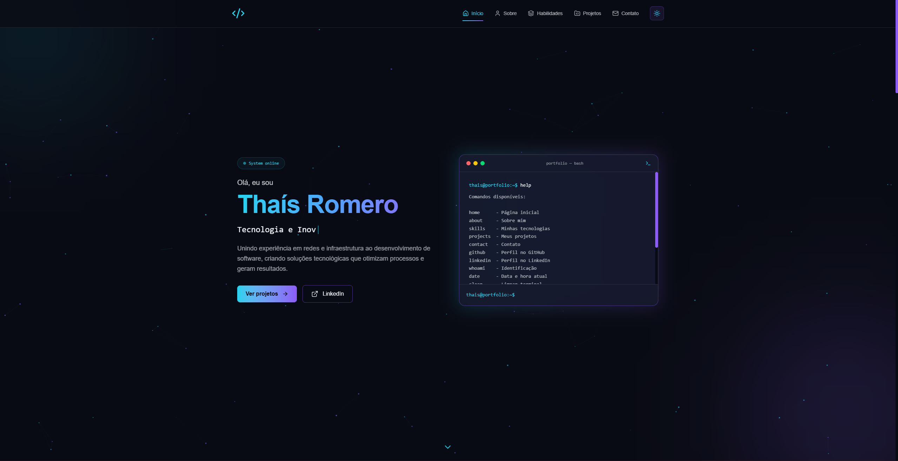
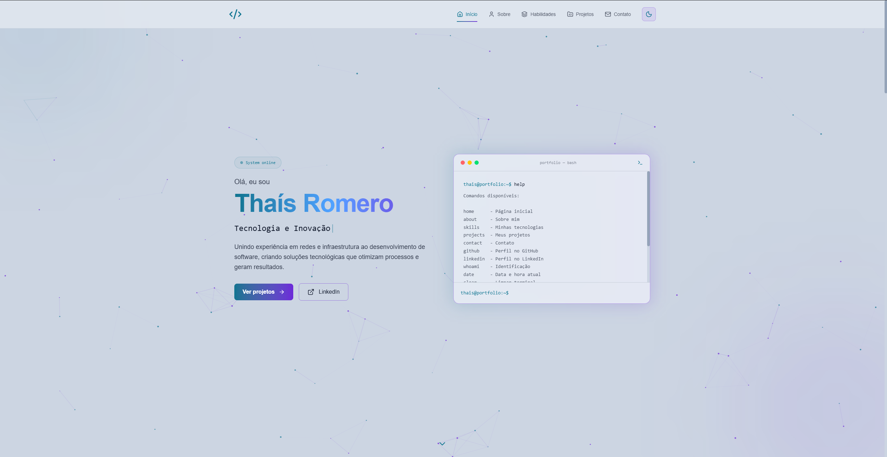
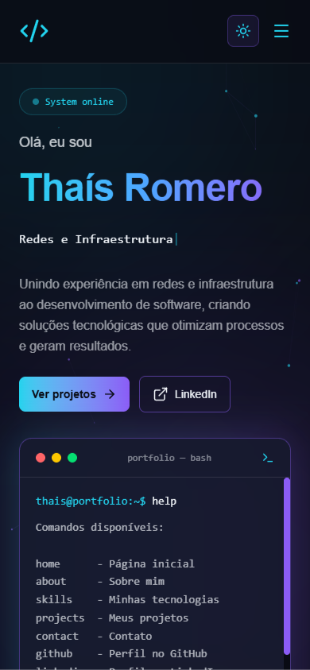
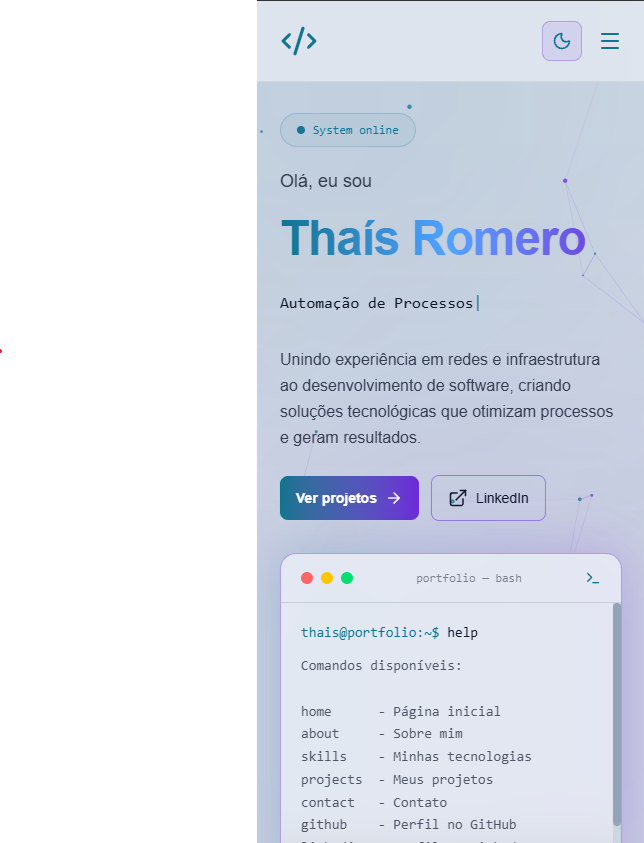
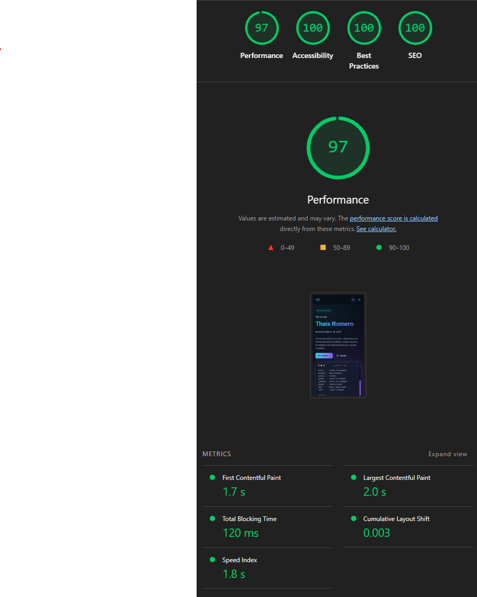

# ⚡ Portfólio Interativo — Thaís Romero


## 📖 Sobre o projeto

Portfólio profissional desenvolvido para apresentar minha trajetória, 
habilidades, conhecimentos e projetos na área de tecnologia.

A aplicação combina uma identidade visual tecnológica com recursos 
interativos, animações e uma arquitetura baseada em componentes, 
valorizando a experiência do usuário, a responsividade e o desempenho.

O projeto também representa a integração entre minha experiência 
profissional em redes e infraestrutura e meus conhecimentos em 
desenvolvimento de software.

## 🖥️ Interface

### Tema escuro



### Tema claro



## 📱 Responsividade

A interface foi desenvolvida para se adaptar a diferentes resoluções,
proporcionando uma experiência consistente em computadores, tablets
e smartphones.

<p align="center">
  
  
</p>

## ✨ Funcionalidades

- Terminal interativo funcional
- Histórico e autocompletar de comandos
- Fundo animado com partículas e conexões
- Efeito de digitação dinâmica
- Temas claro e escuro
- Persistência da preferência de tema
- Navegação com Scroll Spy
- Animações durante a rolagem
- Timeline acadêmica e profissional
- Cards de tecnologias
- Galeria de projetos
- Modais com detalhes dos projetos
- Layout responsivo
- Otimização de SEO e acessibilidade

## 🛠️ Tecnologias utilizadas

| Tecnologia | Aplicação |
|---|---|
| React | Desenvolvimento da interface |
| TypeScript | Tipagem estática |
| Tailwind CSS | Estilização e responsividade |
| Vite | Ambiente de desenvolvimento e build |
| Framer Motion | Animações e transições |
| Canvas API | Fundo interativo de partículas |
| Lucide React | Iconografia |
| React Icons | Ícones de tecnologias |
| ESLint | Análise estática do código |
| Git | Controle de versão |

## 💻 Terminal interativo

O portfólio possui um terminal inspirado em interfaces de linha de
comando, permitindo explorar informações de maneira interativa.

| Comando | Função |
|---|---|
| help | Listar comandos disponíveis |
| about | Conhecer minha trajetória |
| skills | Visualizar tecnologias |
| projects | Conhecer meus projetos |
| contact | Informações de contato |
| github | Acessar meu GitHub |
| linkedin | Acessar meu LinkedIn |
| whoami | Identificação |
| date | Exibir data e hora |
| clear | Limpar o terminal |

## 📊 Desempenho e qualidade

A aplicação foi submetida a testes utilizando o Google Lighthouse
em ambiente local, com a versão de produção.

| Categoria | Pontuação mobile |
|---|---:|
| Performance | 98/100 |
| Accessibility | 100/100 |
| Best Practices | 100/100 |
| SEO | 100/100 |



## 📂 Estrutura do projeto

```text
portfolio/
├── docs/
│   └── images/
├── public/
├── src/
│   ├── assets/
│   ├── components/
│   ├── contexts/
│   ├── data/
│   ├── hooks/
│   ├── sections/
│   ├── styles/
│   ├── utils/
│   ├── App.tsx
│   └── main.tsx
├── index.html
├── package.json
├── vite.config.ts
└── README.md
```

## 🚀 Executando localmente

Clone o repositório:

```bash
git clone https://github.com/ThaisRomero/interactive-portifolio.git
```

Acesse o diretório:

```bash
cd interactive-portifolio
```

Instale as dependências:

```bash
npm install
```

Inicie o ambiente de desenvolvimento:

```bash
npm run dev
```

### Build de produção

```bash
npm run build
```

### Análise estática do código

```bash
npm run lint
```

## 👩‍💻 Autora

**Thaís Romero**

Tecnologia, Desenvolvimento de Software, Redes e Automação.

[](https://www.linkedin.com/in/thais-romero/)

[](https://github.com/ThaisRomero)

---

<p align="center">
  Always learning, always evolving. 💜
</p>
